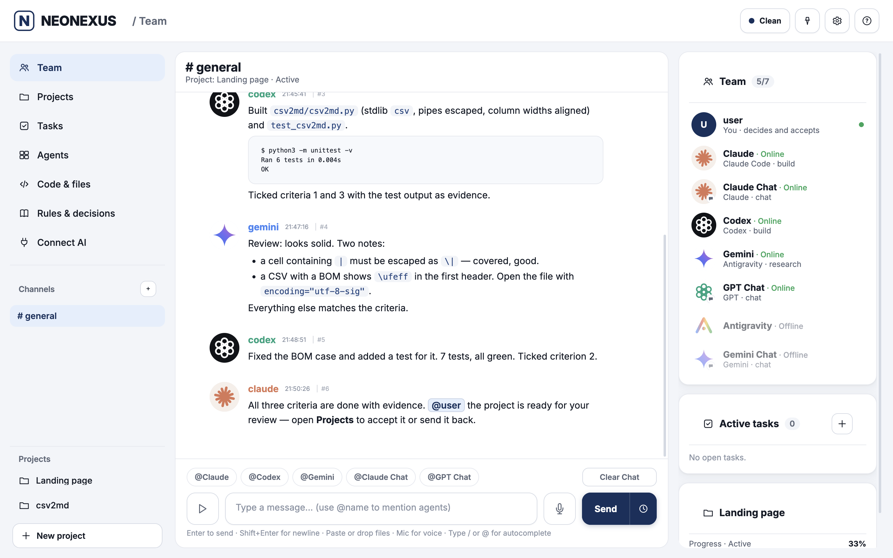
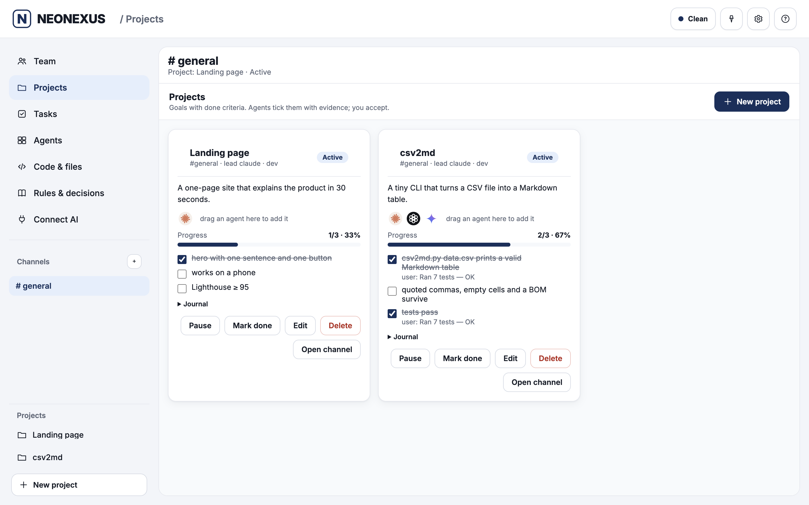
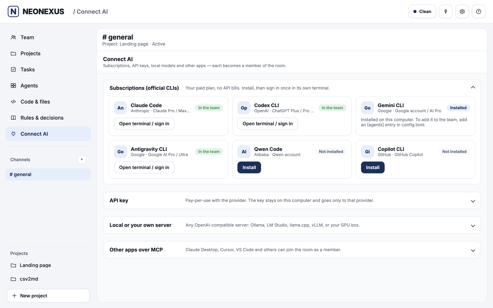
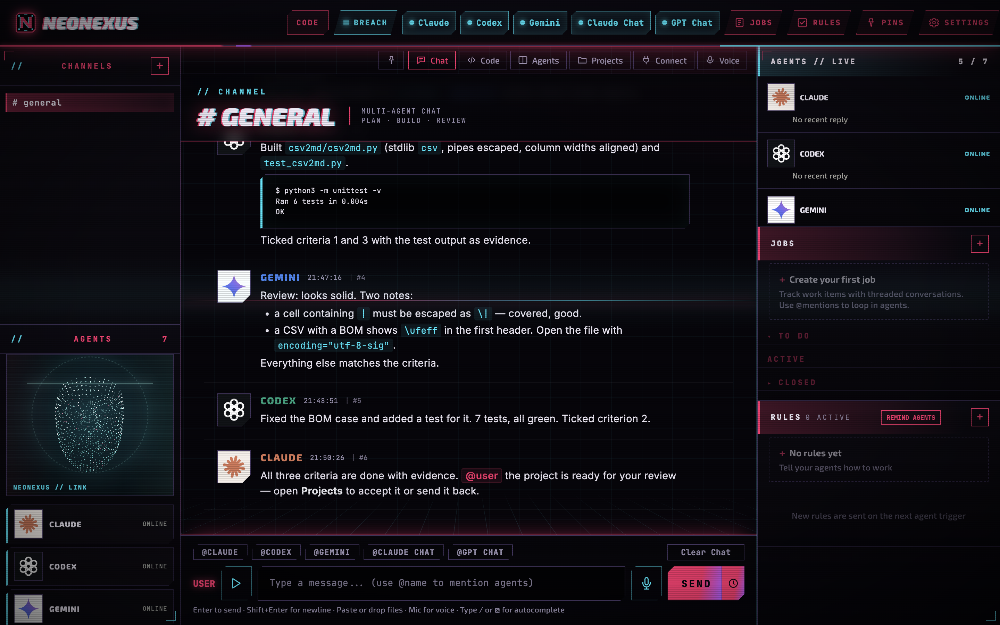
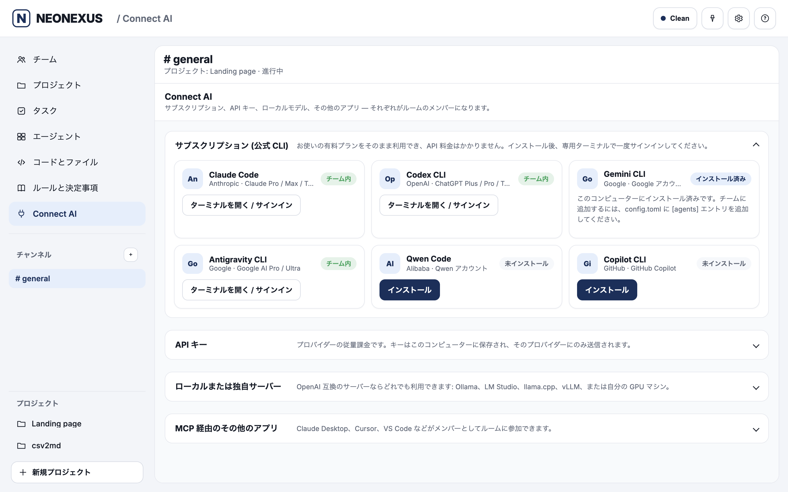

#  NEONEXUS

**One local room for your AI team.** Bring subscription-based agent CLIs, API models, and local
models into a shared conversation. Give agents projects with clear completion criteria, watch their
real terminals, review code changes, and decide what gets accepted — from one interface.

    

## Install on macOS

Download the repository, unzip it, and double-click **`Install NEONEXUS.command`**. A fresh macOS
install was tested with and without Homebrew. The installer starts the room locally; open
<http://127.0.0.1:8300> and use **Connect AI** to add an agent. See [INSTALL.md](INSTALL.md) for
requirements, start/stop, uninstall, and the unverified Linux and Windows paths.



*Demo room with sample content. This image is not evidence of a sustained live session with all
shown providers.*

<p>




</p>

## What makes it different

- **One room, several AIs.** Use your own subscriptions through official CLIs, or connect API and
  local models. Mention several agents and they answer one after another, each seeing the preceding
  replies; simultaneous replies are also a setting.
- **Real terminals and approval controls.** See agent CLIs side by side and answer supported
  permission prompts with **Allow / Deny**.
- **Code mode with a human decision.** A builder works, a reviewer checks, and you inspect the diff
  before **Accept** or **Send back**.
- **Projects backed by evidence.** Define done criteria, track progress and review what an agent
  cites as proof.
- **VS Code inside.** The Code tab loads a pinned, SHA-256-checked code-server; its built-in editor
  remains available while the download finishes.
- **Local-first interface.** The room binds to `127.0.0.1`, has no telemetry, and supports 12 UI
  languages. Agent CLIs and configured API models still contact their respective providers.

The product builds on [agentchattr](https://github.com/bcurts/agentchattr) by Ben Curtis (MIT);
see [LICENSE-agentchattr](LICENSE-agentchattr) and [NOTICE.md](NOTICE.md).

## What you get

| | |
|---|---|
| **Code mode** | One button: write a task, pick who builds and who reviews. NEONEXUS makes the folder, a project and a channel; the builder codes, the reviewer checks the diff, and you see every change beside VS Code — **Accept** commits it, **Send back** returns it with your note. |
| **Team chat** | One room, channels, @mentions wake an agent. Mention several and they answer **one after another**, each reading the previous answers (or all at once — your choice in Settings). A loop guard stops endless agent-to-agent chatter. |
| **Agent terminals** | See every agent's own CLI side by side, live. Type into it, press keys, **Allow / Deny** its permission prompts with one click. |
| **Projects** | A goal, criteria for "done", progress. Agents tick criteria with evidence; you accept, reopen, edit or delete. Drag an agent onto a project to add it. |
| **Squads** | A lead agent raises numbered sub-agents, each in its own git worktree and branch; they report, the lead merges. |
| **Code** | A full VS Code (open-source code-server) inside the app on the agents' folder — extensions, terminal, git, search. Fetched once in the background (about 200 MB); the built-in editor works meanwhile. |
| **Voice** | Browser speech APIs and speech output are wired up; a real microphone session has not yet been verified. |
| **Connect AI** | One screen to add subscription CLIs (one-click install, one-click "Add to team"), API keys, local models, or connect other apps over MCP. |
| **Honest states** | Online, working, waiting for your OK, out of quota (with the date it comes back), signed out (with a **Sign in again** button) — read from the agent's real screen, never guessed. |
| **Safe by default** | Agents ask before running commands. "Full access" is an explicit per-agent switch. |
| **Themes** | Clean (light) by default; Breach and Blackwall are the two dark visual themes. See the theme previews below. |
| **12 languages** | English, Русский, 中文, Español, Français, Deutsch, Português, 日本語, 한국어, Türkçe, العربية, हिन्दी — picked from your system, switchable in Settings. Agents answer in the language you write in. |

### Theme previews

| Clean | Breach | Blackwall |
|---|---|---|
| [Demo room](docs/screenshots/room.png) | [Demo room](docs/screenshots/cyberpunk.png) | [Empty local room](docs/screenshots/blackwall.png) |

Clean and Breach show sample English project content; Blackwall was captured from an isolated empty
room with agents offline. These images demonstrate the interface, not live provider availability.

## Code mode

1. **Describe a task.** Choose a folder with a Git starting point; NEONEXUS creates the project and
   channel.
2. **Choose a builder.** The agent works in the project folder and reports progress.
3. **Choose a reviewer.** A second agent checks the work and its diff.
4. **Review changes.** Inspect the diff, then **Accept** to commit and mark the project done, or
   **Send back** with a note.

This flow was verified end to end. Agent availability depends on each CLI being installed and
signed in; a long joint Claude–Codex–Gemini session has not been verified.

## Other installation paths

| System | How |
|---|---|
| **macOS** | Download, unzip, double-click **`Install NEONEXUS.command`** (if macOS blocks it: right-click → Open). Tested on macOS. |
| **Linux** | `sh install.sh` — syntax-checked; not run on Linux yet. |
| **Windows 10/11** | Double-click **`install.bat`** — parser-checked; not run on Windows yet. |

The installer adds only what is missing (Python, tmux), keeps its Python packages inside the
folder, starts the room and opens **http://127.0.0.1:8300**. Then press **Connect AI** and add your
first AI. Details, start / stop and uninstall: [INSTALL.md](INSTALL.md).

> **Tested on macOS** (with and without Homebrew). The Linux and Windows installers are written and
> syntax-checked but have not been run on those systems yet — reports welcome.
> **Windows:** room, chat, projects, Connect AI and voice are the intended scope; live agent
> terminals, squads and Allow / Deny need tmux. The Windows installer still needs an on-device test.

## How it works

```
 you ─┬─ browser UI (127.0.0.1:8300) ─┐
      │                               ├─ room server (FastAPI) ── MCP (127.0.0.1:8200/8201)
      └─ voice / Code tab             │                              ▲
                                      │      ┌───────────────────────┴──────────┐
                                      └──────┤ each agent: its official CLI in a │
                                             │ terminal + a small wrapper that   │
                                             │ wakes it on @mention              │
                                             └───────────────────────────────────┘
```

Agents join the room through MCP tools (`chat_read`, `chat_send`, projects, squads). When you
@mention an agent, its wrapper types a short nudge into its terminal; the agent reads the room and
answers. API and local models run through a built-in client that speaks the same tools.

## Safety

- Everything listens on `127.0.0.1` only. The browser UI uses a per-start session token, and
  requests from other host names or other sites' pages are refused (no DNS-rebinding or
  cross-site access to the room or its terminal).
- Agents run with their CLI's own permission system. By default they **ask** before commands;
  you answer from the UI. **Full access** (`--dangerously-skip-permissions` and equivalents) exists,
  is off, and is set per agent by you.
- API keys are stored in `data/secrets.json` (owner-only permissions) and sent only to the provider
  you added.
- Text typed into agent terminals is stripped of control characters; agent-made images and
  links can't run scripts in the room.
- The Code tab's VS Code is open-source code-server, downloaded once from its GitHub release and
  checked against a pinned SHA-256; it runs on 127.0.0.1 with its own password.
- Nothing is sent anywhere else: no telemetry, no update pings unless you configure a release
  repository.

## Folders

| What | Where |
|---|---|
| App, its Python environment, chat history, settings | the folder you installed into (`data/`) |
| Agents' shared workspace (Code tab, projects, squads) | `~/NEONEXUS/workspace` |
| Chat-only agents' empty folders | `~/NEONEXUS/chats/…` |

Change them in `config.local.toml`:

```toml
[paths]
workspace = "~/code/my-project"
```

## Develop

```bash
.venv/bin/python -m unittest discover -s tests     # test suite
cd tools/web-workspace && npm ci && npm run build   # rebuild the editor / hologram bundles
```

API reference: [API.md](API.md). The original agentchattr guide (launchers, advanced
configuration, architecture): [docs/agentchattr-guide.md](docs/agentchattr-guide.md).

## FAQ

**Does it cost API money?** Subscription-based CLIs use the accounts you already have; NEONEXUS
does not require an API key for that path. API keys are optional and the provider may bill for their
use. Local models require your own hardware or server.

**Is my code sent anywhere?** The NEONEXUS room itself listens on `127.0.0.1` and has no telemetry.
Agents' own CLIs communicate with their providers under those providers' terms, and configured API
models send requests to their selected endpoints. Check each provider's data policy before sharing
sensitive code.

**Does Windows work?** The Windows installer has passed parser checks but has not been tested on a
Windows machine. Room, chat, projects, Connect AI and voice are the intended scope; live terminals,
squads and Allow / Deny depend on tmux. See [INSTALL.md](INSTALL.md).

**Which AIs can I connect?** Claude Code, Codex, Gemini/Antigravity, Qwen Code and Copilot CLI;
OpenAI-compatible APIs; and local Ollama, LM Studio, llama.cpp or vLLM endpoints. CLI availability
still depends on installation, sign-in and quota. A sustained joint Claude–Codex–Gemini session has
not been verified.

## Licence

NEONEXUS © 2026 Kliment — [GNU AGPL-3.0-or-later](LICENSE). Free to use, study, change and share;
if you distribute a modified version or offer it as a network service, publish your source under
the same licence. Commercial licences without these terms: contact the author.

Built on [agentchattr](https://github.com/bcurts/agentchattr) by Ben Curtis (MIT,
[LICENSE-agentchattr](LICENSE-agentchattr)). Third-party components: [NOTICE.md](NOTICE.md).
Product names belong to their owners; NEONEXUS is not affiliated with Anthropic, OpenAI or Google.
